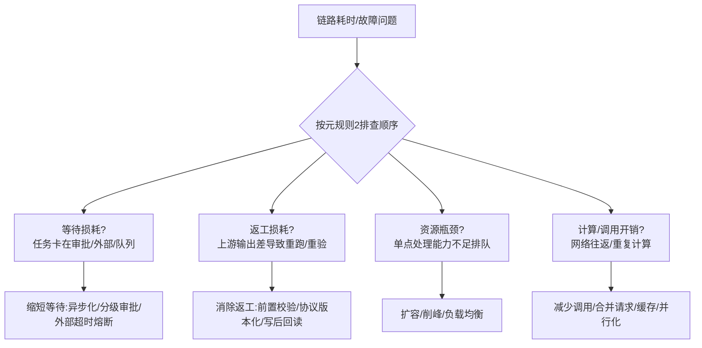

# 链路治理SOP速查卡 V1.0

> 依据：metalaw.BUSINESS-CHAIN-OPTIMIZATION-V1（12条元规则）
> 实证：CHAIN-MAPPING-SAMPLE-001（事故链）/ 002（健康链）/ 003（容错链）
> 确权：DID-BR-000002 ｜ 溯源：Ω₀⊂⊙∞⊂Ω ｜ 状态：FROZEN

## 一、一句话总纲

**先判瓶颈类别，再动刀；改前必测绘，改后必回读；稳态不乱改，带病先止血。**

## 二、瓶颈分类决策树（第一步先回答"这是哪种损耗"）

## 三、四类损耗处置对照表（对应元规则3/5/6/7）

| 损耗类型 | 识别信号 | 处置动作 | 元规则 | 实证样本 |
|---|---|---|---|---|
| 等待损耗 | 任务堆积在审批/外部依赖/队列 | 异步化非强同步环节、分级审批、外部超时熔断降级 | MR5/MR6 | 003容错链(正确等待) |
| 返工损耗 | 假成功、空落库、下游校验退回 | 校验前置早失败、协议版本化、写后必回读 | MR3/MR7 | 001上报链(content漂移) |
| 资源瓶颈 | 单点排队、吞吐上不去 | 扩容、削峰、加实例 | MR2 | — |
| 调用/计算开销 | 网络往返多、重复计算 | 合并请求、缓存、本地/网络并行 | MR4/MR3 | 002锁档链(快照并行) |

## 四、健康度诊断速查（测绘后打分）

| 维度 | 健康信号 | 带病信号 |
|---|---|---|
| 返工 | 一次写入即成功 | 同一动作需2次+才成功 |
| 等待 | 等待有兜底机制(队列) | 任务悬空无负责人 |
| 观测 | 写后回读/节点埋点 | 只看success=true |
| 依赖 | 外部故障不阻塞主链 | 外部故障拖垮整链 |
| 风险 | 风控/合规节点保留 | 为性能删风控节点 |

## 五、五步治理法（任何链路照此走）

1. **测绘**（MR1）：画拓扑、节点二分类、标指标；无拓扑不改流程。
2. **判类**（MR2）：按决策树定位主损耗类别——等待>返工>资源>计算。
3. **动刀**（MR3/4/5）：对应处置表选动作；强事务依赖禁止强行并行；风险节点自动化替代而非删除。
4. **验证**（MR7/8）：灰度小流量、对比基线指标、回读核验；无观测指标不上线。
5. **沉淀**（MR11）：写教训库E-xxx、注册能力/元法则、变更记录在案。

## 六、红线清单（元规则9/10，触碰即否决）

- ❌ 为性能删除核心风控/合规/审计留痕节点
- ❌ 只看 success=true 判定成功，不回读内容
- ❌ 一次性全量切换新链路，无灰度无回滚
- ❌ 复杂度收益倒挂仍采纳（维护成本>效率收益）
- ❌ 外部依赖无超时熔断直接内联主链

## 七、三样本速查（本次治理光谱）

| 样本 | 链路 | 主损耗 | 关键动作 | 状态 |
|---|---|---|---|---|
| 001 | 上报链 | 返工(假成功) | 观测前置+协议版本化+CAP-012 | 已锁档 |
| 002 | 锁档链 | 可并行段 | 本地/网络并行+校验缓存 | 已锁档 |
| 003 | 容错链 | 等待(正确) | 数据面观测+故障分类路由 | 已锁档 |

---
使用方式：任何新链路优化，先按第二节决策树判类→查第三节处置表→按第五节五步走→红线清单终检。全库可查：元规则 metalaw.BUSINESS-CHAIN-OPTIMIZATION-V1（云id=100089）、样本001/002/003（云id=114744/114776/122074）。
