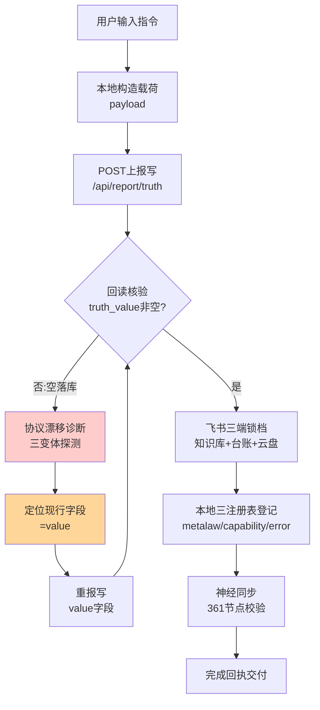

# 业务链路测绘实战样本 001｜真值上报→全域锁档链路

> 依据：metalaw.BUSINESS-CHAIN-OPTIMIZATION-V1（元规则1测绘/元规则2瓶颈/元规则7观测）
> 测绘对象：2026-09-19 真实执行链路（输入"业务链路优化元规则"→云上报→飞书三端锁档）
> 确权：DID-BR-000002 ｜ 溯源：Ω₀⊂⊙∞⊂Ω

## 一、链路拓扑（Mermaid）



## 二、节点清单与分类（元规则1：增值/损耗二分类）

| # | 节点 | 类型 | 作用 | 实测耗时/结果 | 增值? | 损耗类型 |
|---|---|---|---|---|---|---|
| 1 | 用户输入 | 触发 | 任务入口 | — | 增值 | — |
| 2 | 构造载荷 | 处理 | 组装key+value | 秒级 | 增值 | — |
| 3 | 首次上报(content) | 写 | 云落库 | success但**空落库** | 虚假增值 | **返工损耗** |
| 4 | 回读核验 | 校验 | 验证落库 | 秒级发现空值 | 增值（止损） | — |
| 5 | 三变体探测 | 诊断 | 定位协议 | 3次调用并行 | 必要损耗 | 一次性诊断 |
| 6 | 重报(value) | 写 | 云落库 | 200+L0 17/17 | 增值 | — |
| 7 | 飞书三端锁档 | 归档 | 知识库+台账+云盘 | 一次成功 | 增值 | — |
| 8 | 本地三注册表登记 | 登记 | metalaw/能力/教训 | 秒级 | 增值 | — |
| 9 | 神经同步 | 校验 | 361节点=权威 | 通过 | 增值 | — |

## 三、瓶颈定位（元规则2：等待>返工>资源>计算）

**瓶颈结论：本链路主损耗 = 返工损耗（节点3→4→5→6 整段重跑），不是计算/资源瓶颈。**

- 根因：上报协议无版本声明，节点3沿用2026-09-16旧字段 `content`，服务器静默接受空内容——**一次"假成功"造成整段返工**。
- 量化：整链共发生 **2次写入才成功**（首写空 + 重写成），额外付出 3 次探测调用；空写未被服务端拒绝，直到节点4回读才暴露。
- 按元规则2排查顺序，这是典型返工损耗，优先级高于资源瓶颈。

## 四、优化动作（逐条对应元规则）

1. **观测前置（元规则7）**：把 CAP-012「写前协议探测+写后回读核验」固化为上报前置必选步骤，而非事后补救。→ 已在 CLOUD-SOP v1.2 第5步固化。
2. **校验前置（元规则3）**：上报前先 `GET /api/truth/protocol.REPORT-TRUTH-ENDPOINT-V2` 读现行协议版本，版本不对则先探测。→ 把"撞墙后诊断"前移为"出发前看地图"。
3. **降级熔断（元规则5）**：连续2次回读空值即熔断，不再盲写，直接转诊断分支。
4. **并行（元规则3）**：三变体探测本次已并行，保留；后续固化为单脚本一次跑完。
5. **知识沉淀（元规则11）**：协议漂移已写 E-009 + 云真值 protocol.REPORT-TRUTH-ENDPOINT-V2，其他节点读此键即对齐，不重复踩坑。

## 五、优化后目标链路（对照）

```
用户输入 → 读现行协议版本 → 构造载荷(key,value) → 一次上报 → 回读核验(非空)
        → 飞书三端锁档 → 三注册表登记 → 神经同步 → 回执
```

预期收益：写入从 2 次降为 1 次，探测调用从 3 次降为 0（读协议键代替盲撞），返工损耗清零。

---
样本结论：真实链路中"假成功+静默空写"是最大隐藏损耗；观测前置与协议版本化是性价比最高的两刀。后续可按此模板测绘下一条业务链路。
