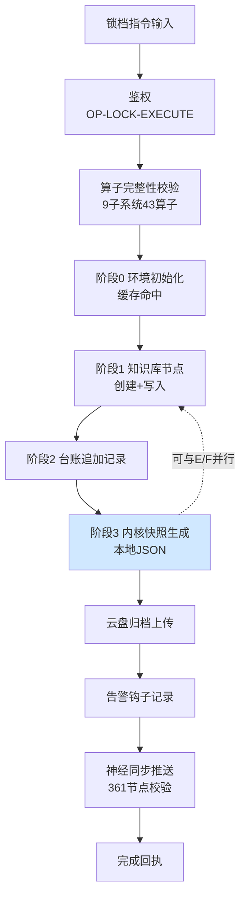

# 业务链路测绘实战样本 002｜三端锁档内部链路

> 依据：metalaw.BUSINESS-CHAIN-OPTIMIZATION-V1（元规则1测绘/元规则2瓶颈/元规则3并行/元规则7观测）
> 测绘对象：kernel_lock.sh 锁档流水线内部流程（2026-09-19 连续两次真实执行：LOCK-METALAW-BCL-001 / LOCK-CHAIN-MAP-001）
> 确权：DID-BR-000002 ｜ 溯源：Ω₀⊂⊙∞⊂Ω

## 一、链路拓扑（Mermaid）

## 二、节点清单与分类

| # | 节点 | 类型 | 作用 | 实测 | 增值? | 备注 |
|---|---|---|---|---|---|---|
| 1 | 锁档指令 | 触发 | 任务入口 | — | 增值 | — |
| 2 | 鉴权 | 安全 | 身份校验 | 通过 | 增值 | 每次必跑 |
| 3 | 算子完整性校验 | 校验 | 9子系统43算子 | 通过 | 增值 | **固定前置开销，可缓存** |
| 4 | 阶段0初始化 | 环境 | 读缓存ID | 零API（命中） | 增值 | 缓存设计已见效 |
| 5 | 阶段1知识库写入 | 网络IO | 建节点+写md | 一次成功 | 增值 | 主耗时 |
| 6 | 阶段2台账写入 | 网络IO | 追加记录 | 一次成功 | 增值 | 与5弱依赖 |
| 7 | 阶段3快照生成 | 本地计算 | 生成JSON | 毫秒级 | 增值 | **无网络，可与5/6并行** |
| 8 | 云盘归档 | 网络IO | 上传文件 | 成功 | 增值 | — |
| 9 | 告警钩子 | 本地 | 记录 | 秒级 | 增值 | — |
| 10 | 神经同步 | 网络IO | 推送361节点 | 第1次即成功 | 增值 | 带1/3次重试容错 |

## 三、瓶颈定位（元规则2）

**结论：本链路无返工/等待类硬瓶颈，主损耗为「串行结构中的可并行段」与「重复固定开销」。**

- 两次真实执行均一次成功、零返工、零重试，说明当前稳态良好。
- 可优化点1：**阶段3快照生成是纯本地计算，却排在阶段1/2网络写入之后串行执行**——本地活等网络活，属可并行损耗（元规则3）。
- 可优化点2：**算子完整性校验每次锁档都重跑**，9子系统43算子属配置态，未变更时可短期缓存结果（元规则4预计算思想）。
- 可优化点3：阶段1（wiki）与阶段2（台账）之间是弱依赖，理论可并行；但并发写冲突（错误表1254291）风险使其维持串行更稳，**此项不动**（元规则10：维护成本>收益则不改）。

## 四、优化动作（对应元规则）

1. **本地活与网络活并行（元规则3）**：阶段3快照生成本地JSON，可与阶段1知识库网络写入同时起跑，预计省一个网络往返的等待。
2. **校验结果短期缓存（元规则4）**：算子完整性校验通过后，5分钟内重复锁档直接复用，避免每次重算。
3. **观测保持（元规则7）**：脚本已逐阶段输出回执、神经同步带节点数校验，满足可观测；无需新增。
4. **不改项（元规则10）**：阶段1/2维持串行，规避并发写冲突；神经同步1/3次重试保留，是网络抖动的正确兜底。

## 五、对比样本001

| 维度 | 样本001（上报链） | 样本002（锁档链） |
|---|---|---|
| 主损耗 | 返工损耗（静默空写） | 可并行段 + 重复固定开销 |
| 根因 | 协议无版本声明 | 串行结构保守 |
| 成熟度 | 有假成功事故 | 稳态零故障 |
| 优化刀 | 观测前置+协议版本化 | 本地/网络并行+校验缓存 |
| 风险 | 改后需防漏校验 | 并行需防快照与写入时序 |

---
样本结论：稳态链路不要硬改——先测绘确认瓶颈类别，再动刀。本样本是"健康链路"范例：瓶颈小、改法克制、守住串行是为了规避并发冲突。
