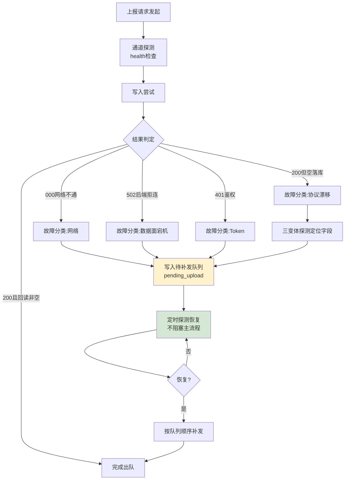

# 业务链路测绘实战样本 003｜容错恢复·待补发队列链

> 依据：metalaw.BUSINESS-CHAIN-OPTIMIZATION-V1（元规则2等待损耗/元规则5降级熔断/元规则9风险兜底）
> 测绘对象：上报故障后的容错恢复链路（真实事件 E-003@09-14、E-007@09-17、E-008@09-18、E-009@09-19）
> 确权：DID-BR-000002 ｜ 溯源：Ω₀⊂⊙∞⊂Ω

## 一、链路拓扑（Mermaid）

## 二、节点清单与分类

| # | 节点 | 类型 | 作用 | 真实事件 | 增值? | 损耗类型 |
|---|---|---|---|---|---|---|
| 1 | 上报发起 | 触发 | 任务入口 | — | 增值 | — |
| 2 | 通道探测 | 观测 | 区分管理面/数据面 | E-007 health=healthy但数据面502 | 增值 | — |
| 3 | 写入尝试 | 主动作 | 上报 | E-003/E-008均502 | 增值 | — |
| 4 | 结果判定 | 分流 | 按状态码分类 | 000/502/401/空值四分支 | 增值 | — |
| 5 | 故障分类路由 | 决策 | 不同故障不同处置 | E-007记录待发、E-009探测字段 | 增值 | — |
| 6 | 待补发队列 | 容错 | 本地存证不丢数据 | pending_upload_20260915/16 | 增值（兜底） | — |
| 7 | 定时探测恢复 | 轮询 | 不阻塞等待 | E-007恢复后补拉 | 必要损耗 | **等待损耗（主）** |
| 8 | 队列补发 | 恢复 | 恢复后顺序补发 | E-008新通道补报成功 | 增值 | — |
| 9 | 完成出队 | 结束 | 校验通过清队列 | — | 增值 | — |

## 三、瓶颈定位（元规则2：等待损耗优先）

**结论：本链路主损耗 = 等待损耗（故障期任务驻留队列等待恢复），但这是"正确的等待"——队列兜底避免了数据丢失。**

- E-003：全端点502，后端宕机，任务只能本地排队等恢复——等待不可消除，只能缩短。
- E-007：`health=healthy` 是个陷阱——管理面活着、数据面死了，若不区分会误判"云OK"而漏掉数据面故障。**观测点必须打到数据面，不能只看管理面健康。**
- E-009（协议漂移空落库）：这是新型故障——服务"成功"但数据丢失，状态码判不出，**必须靠回读真值才能发现**（已固化进CAP-012）。
- 队列机制（CAP-006）本身是元规则9风险兜底的正确实现：失败不丢数据。

## 四、优化动作（对应元规则）

1. **观测打数据面（元规则7）**：通道探测 health 之外，加一个轻量数据面探针（读一条已知真值），管理面/数据面分开判定，避免 E-007 式误判。
2. **故障分类自动路由（元规则3分支收敛）**：000=网络(等/换通道)、502=后端(入队等恢复)、401=Token(换最新)、空落库=协议漂移(探测字段)——四类各走各的分支，不一概盲目重试。
3. **补发时机（元规则2）**：队列任务不主流程阻塞，由每日03:00自动探索机制统一探测补发；避免每条任务各自轮询打爆后端。
4. **空值故障内置（元规则5）**：写后必回读已固化（CAP-012），把"假成功"从被动发现变主动拦截。

## 五、三样本横向对比（链路健康度光谱）

| 样本 | 链路类型 | 主损耗 | 健康度 | 核心动作 |
|---|---|---|---|---|
| 001 上报链 | 生产执行 | 返工(假成功) | 带病运行 | 观测前置+协议版本化 |
| 002 锁档链 | 生产执行 | 可并行段 | 健康稳态 | 本地/网络并行，不乱改 |
| 003 容错链 | 故障恢复 | 等待(必要) | 设计良好 | 数据面观测+故障分类路由 |

---
样本结论：容错链的等待不是缺陷而是兜底成本；优化方向不是消灭等待，而是①观测打到数据面避免误判、②故障分类让每条任务走对分支、③补发集中化不打爆后端。三样本合起来构成"执行-稳态-容错"完整链路治理光谱。
